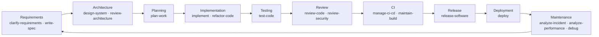
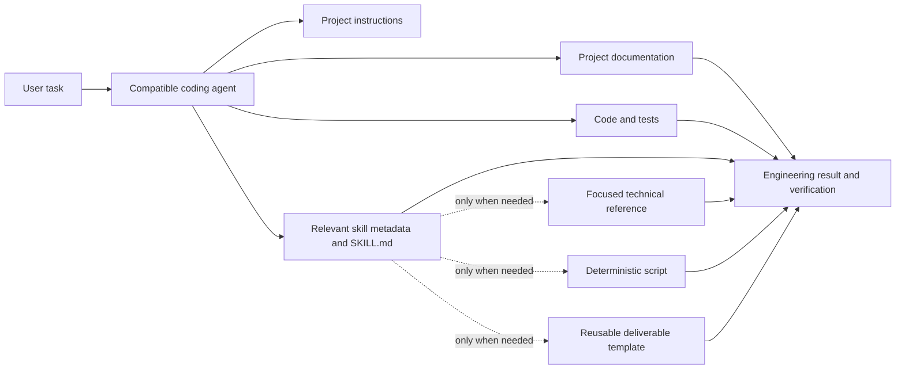

# Engineering Agent Skills

**Portable engineering workflows and technical expertise for AI coding agents.** Use focused skills to review, design, implement, test, debug, release, deploy, and maintain software within the conventions of the project you are working in.

[](https://github.com/ih0r-d/engineering-agent-skills/actions/workflows/validate.yml) [](https://agentskills.io/specification)

This repository is a toolkit, not an agent runtime or orchestration framework. It does not replace Codex, Claude Code, Copilot, or another coding agent, and it does not require a particular model provider. Compatible clients discover and use the skill packages they support.

[Quick Start](#quick-start) · [Agent support](#agent-support) · [Skill catalog](#skill-catalog) · [Architecture](#how-the-toolkit-works) · [Contributing](CONTRIBUTING.md)

## What the toolkit provides

- Workflows spanning the software development lifecycle, from requirements through maintenance.
- Specialist engineering capabilities with explicit scopes, practical steps, and verification guidance.
- Focused technical references that are selected when relevant rather than loaded as a catalog-wide manual.
- Self-contained skill packages with optional executable scripts and reusable engineering templates.
- An offline installer and deterministic checks for package structure, resource links, installation safety, and evaluation data.

Context efficiency is a design objective: agents can select one workflow and load only the details its task needs. No measured token savings or behavioral improvements are claimed.

## Quick Start

### Prerequisites

- Git and Python 3.10 or later.
- A Codex or Claude Code project directory where you can add skill files.
- The local installer makes no network requests; cloning this repository does require network access. For restricted environments, provide a checkout or archive through your existing process.

### Install one skill

From a terminal in the project where you want to use a skill:

```bash
git clone https://github.com/ih0r-d/engineering-agent-skills.git /tmp/engineering-agent-skills
python3 /tmp/engineering-agent-skills/.scripts/skills.py list
python3 /tmp/engineering-agent-skills/.scripts/skills.py install \
  --agent codex \
  --target "$PWD" \
  --skill review-code \
  --mode copy \
  --dry-run
```

Review the preview, then repeat the install command without `--dry-run`. For example, install more than one skill with `--skill review-code,test-code`, select both installer-supported clients with `--agent all`, or select the whole catalog with `--all`.

Project installation paths are `.agents/skills/<skill-id>/` for Codex and `.claude/skills/<skill-id>/` for Claude Code. The installed package is flat even though source skills are grouped by category. Open or reload the project in the agent, then ask a task-specific question such as:

> Review the changed Java code for concurrency and public API compatibility. Show evidence and verification steps; do not modify files.

You can also explicitly invoke a skill using the client’s supported syntax, such as `$review-code` in Codex or `/review-code` in Claude Code. Invocation and automatic skill selection depend on the client and its configuration.

## Agent support

The installer and client compatibility are separate: the installer creates directories, while each agent controls skill discovery and invocation.

| Client | Installer target | Documented skill locations | Compatibility status |
| --- | --- | --- | --- |
| Codex | Yes; project and user scope | `.agents/skills/`, `~/.agents/skills/` | Destination layouts are covered by installer tests; live routing is client/version dependent. |
| Claude Code | Yes; project and user scope | `.claude/skills/`, `~/.claude/skills/` | Destination layouts are covered by installer tests; live routing is client/version dependent. |
| GitHub Copilot | No | Surface-specific locations include project `.agents/skills/` and personal skill directories. | Agent Skills support and locations are documented. Use client-specific setup; this installer does not target Copilot, and runtime discovery is not independently verified here. |

Clients that implement the [Agent Skills specification](https://agentskills.io/specification) may be able to use the portable packages through their own discovery paths. The standard does not guarantee that every client implements every capability. Check the client’s current setup documentation before choosing a location.

- [Codex skill documentation](https://developers.openai.com/codex/skills)
- [Claude Code skills](https://code.claude.com/docs/en/skills)
- [GitHub Copilot Agent Skills](https://docs.github.com/en/copilot/concepts/customizations/agent-skills)
- [Installer and client compatibility notes](docs/compatibility.md)

## Installation modes

The built-in installer is Python 3.10+ and standard-library only. It supports project scope (selected with `--target`) and user scope (selected with `--scope user`; omit `--target`). It manages only verified installations and protects unmanaged or locally modified resources.

| Mode | Behavior | Use when |
| --- | --- | --- |
| **Symlink** (default) | Installs a relative link to the selected source package. Changes in that checkout are immediately reflected in the installed skill. | The source checkout will remain available at its current relative location. |
| **Copy** (`--mode copy`) | Installs a self-contained snapshot and preserves bundled executable permissions. | You need independent files, cannot use symlinks, or want to keep the source checkout elsewhere. |

To update an installation, use the same installer that created it. A symlink follows its source checkout; refresh a copied installation by uninstalling and reinstalling. Use `--dry-run` to preview removal or installation. The installer does not modify project instructions, build files, the Git index, or user-level agent configuration.

```bash
# Install for a user account (omit --target for user scope)
python3 /tmp/engineering-agent-skills/.scripts/skills.py install \
  --agent codex --scope user --skill review-code --dry-run

# Remove a project installation after reviewing the preview
python3 /tmp/engineering-agent-skills/.scripts/skills.py uninstall \
  --agent codex --target "$PWD" --skill review-code --dry-run
```

When upgrading from a revision with replaced skill IDs, uninstall them before updating the toolkit checkout. Then install the v2 IDs and update explicit invocations. [Upgrade steps and recovery](docs/compatibility.md#migrating-to-v2)

### Pin a checkout with a Git submodule

For a repository-pinned toolkit revision, add it as a submodule in the consuming repository and install from that checkout:

```bash
git submodule add \
  https://github.com/ih0r-d/engineering-agent-skills.git \
  .tooling/engineering-agent-skills
./.tooling/engineering-agent-skills/.scripts/install.sh \
  --agent all \
  --target "$PWD" \
  --skill review-code,documentation-quality \
  --dry-run
```

Review the preview, then rerun without `--dry-run`. The installer creates relative symlinks by default; the submodule and project should move together. Initialize the pinned checkout after cloning with `git submodule update --init --recursive`. Adding or updating the submodule changes consumer-repository Git metadata; the skill installer itself does not run Git commands.

## Example engineering tasks

Prompts describe user intent; they do not guarantee that a specific client will select a particular skill automatically. Skills can be invoked explicitly where the client supports it.

- “Draft a specification for checkout retries with observable acceptance criteria for duplicates and partial failures.” — `write-spec`.
- “Clarify which checkout failures can be retried and who decides the duplicate-charge policy.” — `clarify-requirements`.
- “Simplify repeated parsing without changing which inputs are accepted.” — `refactor-code`.
- “Assess the existing order service's data ownership and failure propagation.” — `review-architecture`.
- “Implement the approved checkout retry contract and verify the acceptance criteria.” — `implement`.
- “Review this Java change for data races, `CompletableFuture` cancellation, and binary API compatibility.” — `review-code` with its Java review guidance.
- “Investigate this `OutOfMemoryError: Metaspace`; compare classloader activity and available JVM evidence before suggesting tuning.” — `debug` with its JVM diagnostics guidance.
- “Diagnose why the GitHub Actions deploy job cannot retrieve an artifact produced by an earlier job.” — `manage-ci-cd`.
- “Prepare a production hotfix and backport plan. Identify the target release lines and tests; do not push, tag, publish, or deploy.” — `debug`, `manage-git`, and `release-software` as relevant.
- “Design a Spring Boot service and draft an ADR for the selected persistence boundary. Do not implement it.” — `design-system`.
- “Create a risk-based test strategy for a Spring Boot service that reserves inventory and charges cards.” — `test-code`.

Composition is task-dependent. The toolkit does not provide an orchestration runtime or mandatory multi-skill pipeline.

## Skill catalog

The catalog below is generated from `catalog.json` and each skill’s YAML frontmatter. To refresh it, run `task docs:generate`; `task docs:check` and CI verify that it is current.

<!-- BEGIN GENERATED SKILL CATALOG -->

**Inventory:** 24 skills · 7 categories · 83 references · 7 assets · 1 script · 148 evaluation cases.

### Software Engineering

| Skill | Purpose |
| --- | --- |
| [`implement`](skills/software-engineering/implement/SKILL.md) | Implement an approved feature or intentional change to software behavior. Use for scoped source changes against requirements, acceptance criteria, and existing caller contracts. |
| [`review-code`](skills/software-engineering/review-code/SKILL.md) | Review a pull request, patch, or scoped code change for actionable defects, regressions, and missing verification. Use for a findings-first review of proposed or existing changes. |
| [`refactor-code`](skills/software-engineering/refactor-code/SKILL.md) | Improve existing code structure while preserving observable behavior. Use for scoped simplification, consolidation, or separation of responsibilities with a behavior baseline. |

### Software Architecture

| Skill | Purpose |
| --- | --- |
| [`design-system`](skills/software-architecture/design-system/SKILL.md) | Design software architecture, define API contracts, or evaluate and record an architecture decision. Use for proposed component boundaries, data ownership, system trade-offs, consumer compatibility, and ADRs. |
| [`review-architecture`](skills/software-architecture/review-architecture/SKILL.md) | Assess existing software architecture against requirements, quality attributes, and operational constraints. Use for architecture audits, component boundaries, coupling, data ownership, scalability, reliability, and architectural risk assessment. |

### Bug Fixing and Reliability

| Skill | Purpose |
| --- | --- |
| [`debug`](skills/bug-fixing-and-reliability/debug/SKILL.md) | Diagnose software failures, analyze recurring causes, or apply an authorized defect fix. Use for intermittent failures, runtime diagnostics, environment differences, and verified corrections that restore expected behavior. |
| [`analyze-performance`](skills/bug-fixing-and-reliability/analyze-performance/SKILL.md) | Analyze software performance using measurements, profiling, workload characteristics, and resource usage. Use for latency, throughput, CPU, memory, I/O, contention, and scalability bottlenecks. |
| [`analyze-incident`](skills/bug-fixing-and-reliability/analyze-incident/SKILL.md) | Analyze an operational incident and prepare an evidence-based incident report or blameless postmortem. Use for impact, incident timelines, response effectiveness, recovery, and follow-up actions. |

### Testing and Quality Assurance

| Skill | Purpose |
| --- | --- |
| [`test-code`](skills/testing-and-quality-assurance/test-code/SKILL.md) | Plan risk-based verification or write, review, and run unit, integration, and contract tests. Use for coverage decisions, test isolation, regression checks, and cross-component behavior. |
| [`review-security`](skills/testing-and-quality-assurance/review-security/SKILL.md) | Review software changes, architecture boundaries, and configuration for security vulnerabilities and exposure risks. Use for authorized defensive assessments, access control, sensitive data handling, and evidence-based remediation advice. |

### Software Delivery

| Skill | Purpose |
| --- | --- |
| [`maintain-build`](skills/software-delivery/maintain-build/SKILL.md) | Review, repair, or verify build automation and dependency resolution. Use for build graphs, task runners, reproducibility, package manifests, lockfiles, and scoped dependency upgrades. |
| [`maintain-containers`](skills/software-delivery/maintain-containers/SKILL.md) | Review or fix container image builds, runtime settings, and local service orchestration. Use to diagnose image reproducibility, secret handling, startup, health, shutdown, or local development behavior. |
| [`manage-ci-cd`](skills/software-delivery/manage-ci-cd/SKILL.md) | Design, review, or repair continuous integration and delivery pipelines. Use for workflow triggers, job dependencies, quality gates, caching, permissions, and pipeline reliability. |
| [`manage-git`](skills/software-delivery/manage-git/SKILL.md) | Plan or perform scoped Git workflows, atomic commits, Conventional Commits, task identifiers, branches, pull requests, and conflict resolution. Use for repository history and change organization. |
| [`release-software`](skills/software-delivery/release-software/SKILL.md) | Audit release readiness or prepare versions, changelogs, release notes, and artifact and CI validation. Use for compatibility, publishing checks, provenance, or rollback planning before a release. |
| [`deploy`](skills/software-delivery/deploy/SKILL.md) | Plan, review, or verify software deployment and rollout procedures. Use for environment promotion, rollout strategies, runtime readiness, migrations, rollback, and deployment verification. |

### Engineering Productivity

| Skill | Purpose |
| --- | --- |
| [`clarify-requirements`](skills/engineering-productivity/clarify-requirements/SKILL.md) | Clarify stakeholder needs, business rules, constraints, and acceptance criteria. Use for ambiguous scope, conflicting requirements, and decisions that block agreement on expected behavior. |
| [`write-spec`](skills/engineering-productivity/write-spec/SKILL.md) | Draft, review, or update a software specification. Use for durable requirements documents, observable acceptance criteria, traceability, and specification changes with recorded decision status. |
| [`plan-work`](skills/engineering-productivity/plan-work/SKILL.md) | Plan implementation or decompose an approved engineering objective into verifiable work items. Use for sequencing a scoped change, delivery slices, backlog dependencies, migration, and verification planning. |
| [`write-docs`](skills/engineering-productivity/write-docs/SKILL.md) | Write, review, or verify READMEs, quick starts, consumer guides, architecture and contributor docs, API reference, JavaDoc, Python docstrings, and examples. Use to investigate documentation drift or broken instructions. |
| [`handoff`](skills/engineering-productivity/handoff/SKILL.md) | Prepare or review engineering handoffs using verified repository state, completed work, decisions, checks, risks, and next actions. Use for transferring ownership or resuming interrupted technical work. |

### AI Engineering

| Skill | Purpose |
| --- | --- |
| [`author-skills`](skills/ai-engineering/author-skills/SKILL.md) | Create, review, or refactor portable Agent Skills. Use when defining skill scope, activation conditions, workflows, references, scripts, or specification compliance; combine with domain skills when their expertise is relevant. |
| [`evaluate-skills`](skills/ai-engineering/evaluate-skills/SKILL.md) | Design or run behavioral evaluations of agent skills. Use for routing, instruction following, task correctness, baseline comparisons, regression analysis, and evaluation rubrics. |
| [`manage-agent-context`](skills/ai-engineering/manage-agent-context/SKILL.md) | Select and preserve task context, design or refine agent prompts, or measure token efficiency. Use for instruction placement, retrieval scope, output contracts, handoff summaries, and reducing redundant context or tool output. |

<!-- END GENERATED SKILL CATALOG -->

## Software development lifecycle

The catalog covers each lifecycle stage through focused, composable skills. A project or agent can select the relevant capabilities; the arrows show a common relationship, not an automatic pipeline.



## How the toolkit works

Clients differ in how they locate and load instructions. This is a conceptual model, not a guaranteed universal loading order or precedence rule.



Project instructions supply repository-specific policy; the skill supplies a reusable workflow; references contain deeper subject expertise; scripts perform deterministic operations; assets provide reusable output structures. Project documentation, code, and tests supply the evidence. Select references using the requested outcome and the relevant technology, framework, and version. Explicit user requirements take precedence over inferred choices. Use the generic workflow and project conventions when no relevant reference applies. [V2 scope and extension policy](SCOPE.md)

Implementation, refactoring, debugging, and code review can use native subagents for independent tasks when available and authorized. The primary agent verifies combined results and follows the same workflow sequentially when delegation does not apply.

### Skill package anatomy

```text
skill-id/
├── SKILL.md       # purpose, activation, workflow, constraints, verification
├── references/    # optional, selectively loaded technical guidance by topic or technology
├── scripts/       # optional, tested deterministic operations
└── assets/        # optional, reusable templates and data
```

Each skill is a self-contained package; references, scripts, and assets are optional. The source repository groups packages under `skills/<category-id>/<skill-id>/`; the installer places each package flat under its skill ID. This repository recommends roughly 30–100 lines for most entrypoints and prefers fewer than 1,500 tokens. These are local advisory targets, not Agent Skills format requirements; necessary instructions take precedence.

### Repository map

| Path | Role |
| --- | --- |
| `skills/<category>/<skill>/` | Categorized source packages and their optional resources |
| `catalog.json` | Single source for skill IDs and category membership |
| `evals/` | Modular routing cases, fixtures, and evaluation protocol |
| `docs/` | Architecture, compatibility, authoring, audit, and evaluation guidance |
| `templates/` | Adaptable skill and project-instruction examples |
| `tests/` | Offline regression and specification tests |
| `.scripts/` | Installer, validators, documentation generator, and maintainer checks |
| `scripts/` | Historical compatibility entrypoints |
| `.github/workflows/` | GitHub Actions validation workflow |
| `Taskfile.yml` | Local validation and documentation tasks |

## Quality assurance and evaluation

Deterministic checks validate format, catalog membership, resource boundaries, installer behavior in copy and symlink modes, bundled scripts, local Markdown links, evaluation schemas, fixtures, and routing-case coverage. These checks establish repository structure and test tooling behavior.

The evaluation suite describes expected routing and behavior; case inventory is shown above. Cases are not successful model runs. Live evaluation requires an AI agent and the protocol in [evals/README.md](evals/README.md); live behavioral effectiveness has not been established by deterministic checks. Performance, token, latency, and cost comparisons are future measurement work.

## Contributing and development

Maintainer checks require Python 3.11+, Task, uv, Bash, ShellCheck, actionlint, zizmor, and Lychee. End-user installation does not require Task or the maintainer toolchain.

```bash
task validate       # catalog, resources, and specification gate
task test           # deterministic unit and regression tests
task eval:check     # evaluation schema, routing, and fixtures
task eval:plan      # native Codex pilot scenarios and budget, offline
task docs:generate  # update generated README catalog
task docs:check     # catalog freshness and Markdown links
task ci             # full maintainer quality gates
```

See [CONTRIBUTING.md](CONTRIBUTING.md), the [canonical Skill Authoring Standard](docs/skill-authoring.md), [repository architecture](docs/architecture.md), [context architecture](docs/context-architecture.md), and the [evaluation protocol](evals/README.md).

## Project direction

**Completed foundations:** categorized skill catalog, context architecture, Authoring Standard v2, technical references, modular evaluation cases, standalone package portability, and reusable scripts and assets.

The [native Codex pilot](evals/behavioral-baseline.md) is ready for explicitly authorized behavioral baseline runs. Offline validation remains separate from live evaluation.

## License

There is no `LICENSE` file in this repository. The source is publicly visible, but a license has not been selected; consult the maintainers before assuming reuse or redistribution permissions.
